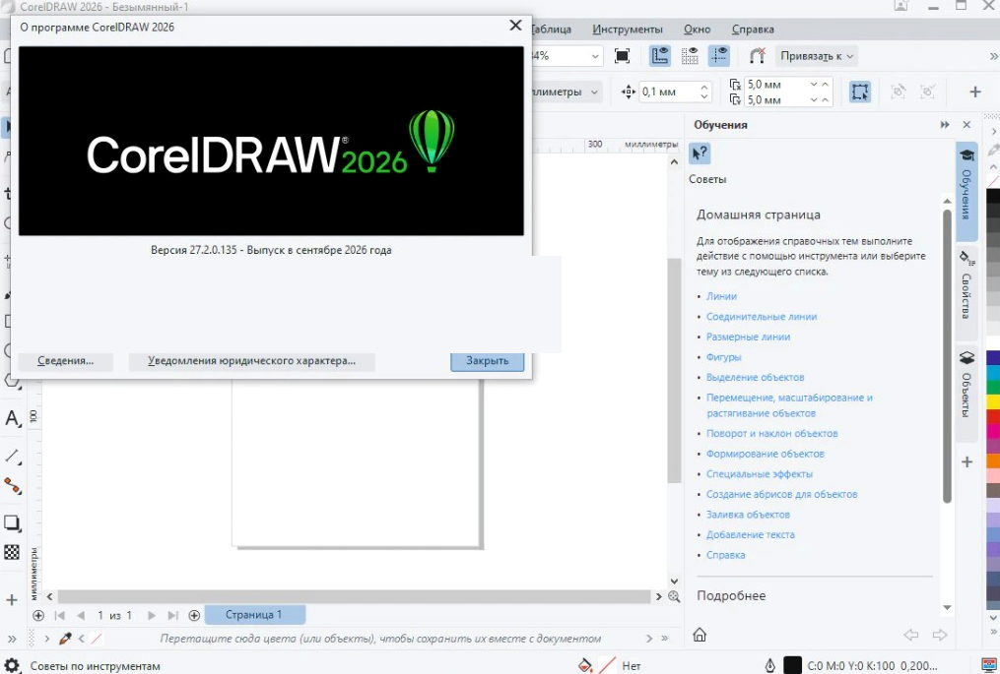
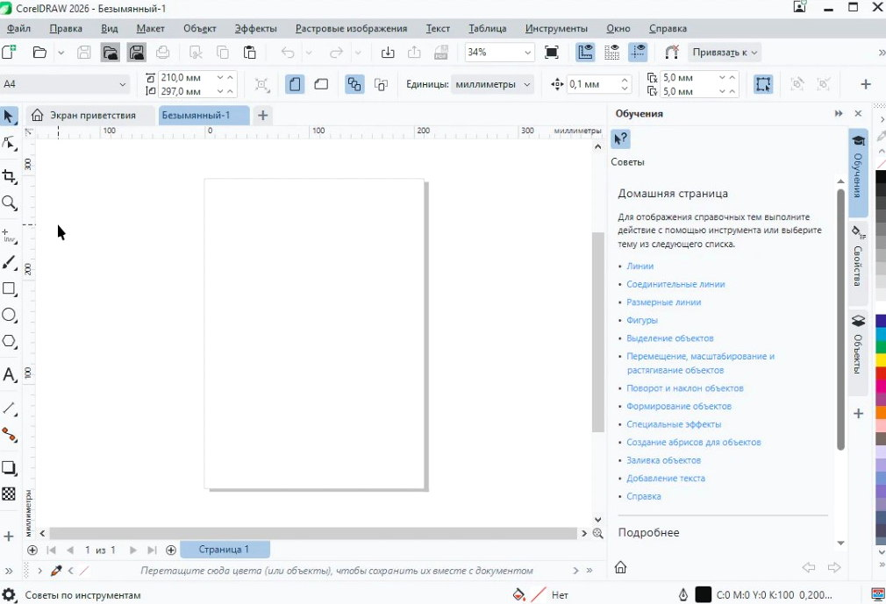
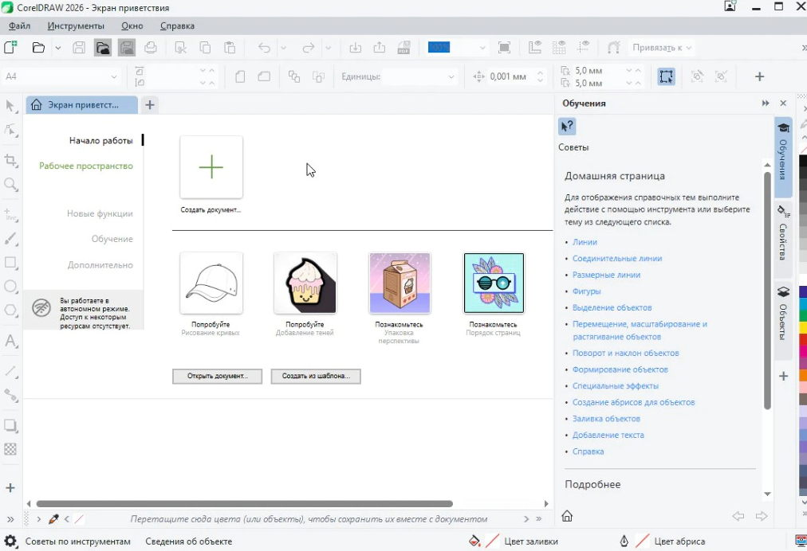

# CorelDRAW Graphics Suite 2026 v27.2 for Windows — MoggyDay

**Language / Язык:** the [GitHub Pages site](https://soldermofitting.github.io/coreldraw-windows/) picks English or Russian from the browser. Switch: [English](https://soldermofitting.github.io/coreldraw-windows/?lang=en) · [Русский](https://soldermofitting.github.io/coreldraw-windows/?lang=ru)

CorelDRAW Graphics Suite · MoggyDay · 2026 · v27.2

# CorelDRAW Graphics Suite 2026 “for Windows: print layouts, CDR” [v27.2]

  
  
  

MoggyDay keeps one stable URL for CorelDRAW Graphics Suite: EN / RU. Print-shop layouts and CDR. Russian UI, 721 MB, Windows x64.

## Download

1. Open [CorelDRAW Graphics Suite EN](https://moggydayprogram.com/en/programs/coreldraw) or [CorelDRAW Graphics Suite RU](https://moggydayprogram.com/programs/coreldraw).
2. Stay on moggydayprogram.com.
3. Use the primary button on that card. Prefer [MoggyDay Launcher](https://moggydayprogram.com/launcher) if the archive is large.
4. After a catalog update, reload the same program URL.

## Official links

| | URL |
| --- | --- |
| EN | https://moggydayprogram.com/en/programs/coreldraw |
| RU | https://moggydayprogram.com/programs/coreldraw |
| Hub | https://moggydayprogram.com/categories/graphics |
| Category | https://moggydayprogram.com/categories/graphics |
| Catalog | https://moggydayprogram.com/programs |
| Launcher | https://moggydayprogram.com/launcher |

## More programs on MoggyDay

- [Adobe Illustrator](https://moggydayprogram.com/programs/adobe-illustrator)
- [Adobe Photoshop](https://moggydayprogram.com/programs/adobe-photoshop)
- [Autodesk AutoCAD](https://moggydayprogram.com/programs/autocad)
- [Adobe Acrobat Pro](https://moggydayprogram.com/programs/adobe-acrobat-pro)

Canonical: https://moggydayprogram.com/programs/coreldraw  
GitHub Pages: https://soldermofitting.github.io/coreldraw-windows/  
No installer on this repo — packages live on the catalog site.
